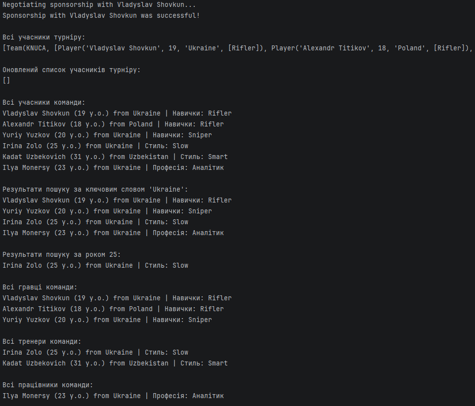
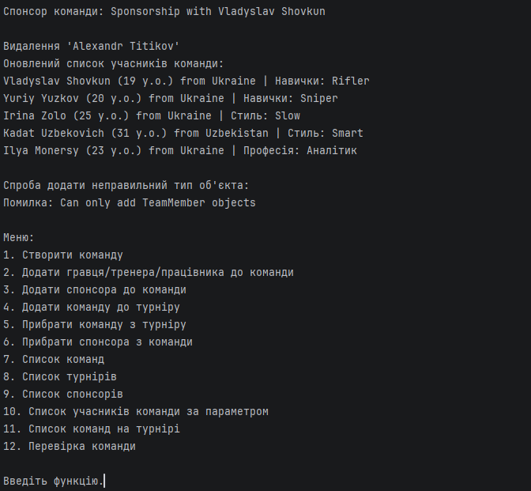

# Звіт до лабораторної роботи №5         67

## Тема: Основи ООП в Python (Team Project)

## Варіант: `7`

---

### 1. Склад команди

| ПІБ студента | Роль у проєкті | GitHub |
| :----------- | :-------------- | :----- |
| `Шовкун Владислав Станіславович`    | `(Developer 1)` | `https://github.com/Rorty291` |
| `(акулов і.о)`    | `(Developer 2)` | `https://github.com/vanya6677` |

---

### 2. Розподіл завдань

Детально опишіть, хто за яку частину проєкту був відповідальний.

-   **`Шовкун Владислав Станіславович`**:
    -   `Завдання 1. Розробка абстрактного класу TeamMember`
    -   `Завдання 2. Розробка підкласів Player, Coach, Staff`
    -   `Завдання 3. Розробка класу-менеджера Team`
    -   `Завдання 4. Розробка методів пошуку та сортування у класі-менеджері`
    - `Завдання 5. Написання модульних тестувань для всіх нових классів.`
    -   `...`

-   **`(акулов і.о)`**:
    -   `Завдання 1 Створення класу Tournament, Sponsor, TrainingProgram`
    -   `Завдання 2 Cтворення ключових методів organizePractice(), participate_tournament(), negotiate_sponsorship()`
    -   `...`

---

### 3. Опис архітектури проєкту

Опишіть основні класи вашого проєкту, їхню взаємодію та загальну логіку програми. Можна додати UML-діаграму класів.

#### Клас `TeamMember`
-   **Призначення:** `Цей абстрактний клас є основою для всіх його нащадків.`
-   **Атрибути:** `name, age, country`
-   **Методи:** `name, age, country`

#### Клас `Player`
-   **Наслідує:** `TeamMember`
-   **Призначення:** `Цей під клас створює гравців для команди з додатковим атрибутом, який задає навички гравця`
-   **Додаткові атрибути/методи:** `abilities`

#### Клас `Coach`
-   **Наслідує:** `TeamMember`
-   **Призначення:** `Цей під клас створює тренерів для команди з додатковим атрибутом, який задає стиль тренера`
-   **Додаткові атрибути/методи:** `style`

#### Клас `Staff`
-   **Наслідує:** `TeamMember`
-   **Призначення:** `Цей під клас створює працівників для команди з додатковим атрибутом, який задає професію працівника`
-   **Додаткові атрибути/методи:** `profession`

#### Клас `Tournament`
-   **Призначення:** `Цей клас створює турніри у які потім можуть вступати/виходити команди`
-   **Основні методи:** `participate_tournament(team) - додає команду до турніру, leave_tournament(team) - видаляє команду з турніру`

#### Клас `Sponsor`
-   **Призначення:** `Цей клас створює спонсорів з якими команди можуть переговорювати.`
-   **Основні методи:** `negotiate_sponsorship() - вступає в переговори зі спонсором`

#### Клас `TrainingProgram`
-   **Призначення:** `Цей клас створює програми тренування для команд.`
-   **Основні методи:** `organize_practice(practice) - розпочинає тренування.`

#### Клас `Team`
-   **Призначення:** `Керує підкласами Player, Staff та Coach для створювання учасників команди.`
-   **Основні методи:** `recruit_member(member) - додає учасника до команди, negotiate_sponsor(sponsor) - веде переговори зі спонсором, search(keyword) - шукає учасників команди за аргументом`

---

### 4. Демонстрація роботи

`(Приклад виводу з консолі)`

---

### 5. Висновки

У цій лабораторній роботі ми дізналися як створювати великі ООП програмами з абстрактними та звичайними класами. Труднощі вийшли на початку розробки зі злиттям версій коду. А в кінці проблеми через різні версії Python, які використовувалися у нас на комп'ютерах.